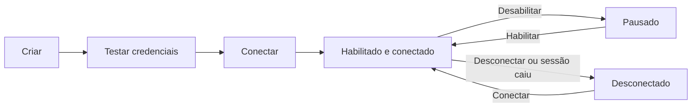
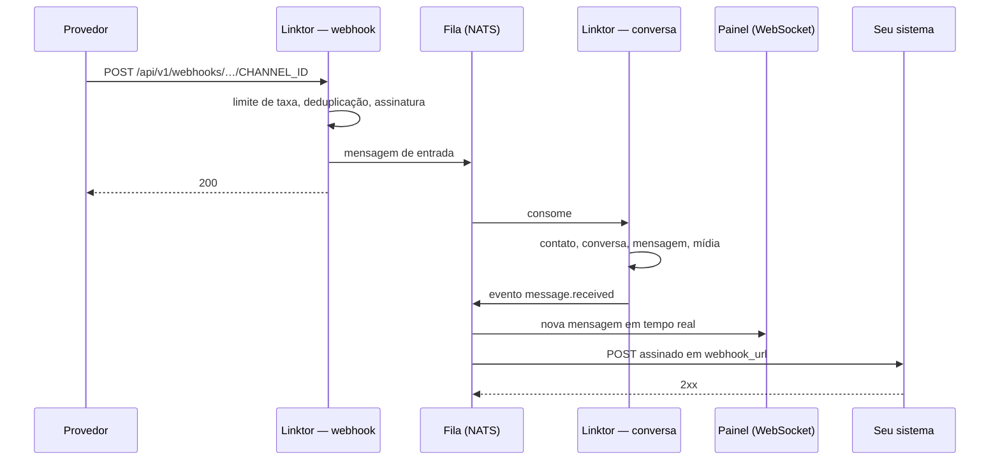
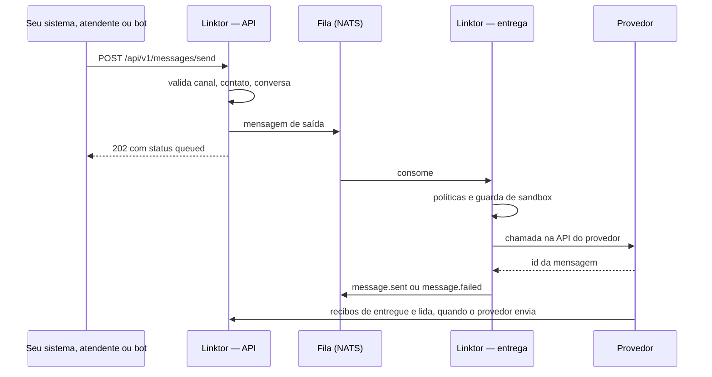

# Visão geral dos canais

Um **canal** é uma conexão da sua empresa com um meio de mensagem: um número de WhatsApp, um bot
do Telegram, uma caixa de e-mail, um widget no site. Cada canal tem suas credenciais, seu status
de conexão e, se você quiser, um endereço do seu sistema para receber os eventos. Toda conversa
pertence a exatamente um canal.

Esta página explica o que vale para todos os tipos. O passo a passo de cada provedor está na
página do canal.

## Tipos de canal

| Canal | `type` | Origem | Como conecta | Página |
|---|---|---|---|---|
| WhatsApp Business | `whatsapp_official` | Meta — WhatsApp Cloud API | Token de acesso + id do número, ou cadastro incorporado (OAuth) | [WhatsApp oficial](./whatsapp-oficial.md) |
| WhatsApp (não oficial) | `whatsapp` | Sessão do WhatsApp mantida pelo próprio servidor | QR Code ou código de pareamento | [WhatsApp não oficial](./whatsapp-nao-oficial.md) |
| Instagram | `instagram` | Meta — Graph API | OAuth ou token | [Instagram](./instagram.md) |
| Facebook Messenger | `facebook` | Meta — plataforma Messenger | OAuth ou token de página | [Facebook](./facebook.md) |
| Telegram | `telegram` | Bot API do Telegram | Token do bot | [Telegram](./telegram.md) |
| Web Chat | `webchat` | Widget do próprio Linktor | Trecho de código no site | [Web Chat](./webchat.md) |
| E-mail | `email` | SMTP/IMAP ou provedor de e-mail transacional | Usuário e senha, ou chave de API do provedor | [E-mail](./email.md) |
| SMS | `sms` | Twilio | Credenciais da conta | [SMS](./sms.md) |
| RCS | `rcs` | Provedor de RCS | Chave de API do provedor | [RCS](./rcs.md) |
| Voz | `voice` | Provedor de telefonia | Credenciais do provedor | [Voz](./voz.md) |
| Slack | `slack` | Slack — Events API e Web API | Token do bot + signing secret | [Slack](./slack.md) |
| Microsoft Teams | `teams` | Microsoft Bot Framework | App ID + segredo do cliente | [Teams](./teams.md) |
| Mattermost | `mattermost` | Servidor Mattermost (WebSocket) | URL do servidor + token do bot | [Mattermost](./mattermost.md) |
| Direto (VendaX) | `direto` | Aplicativo de chat VendaX Direto | URL do runtime + token + segredo | [Direto](./direto.md) |

### `whatsapp`, `whatsapp_unofficial` e `whatsapp_official` {#tipos-whatsapp}

Existem três valores de `type` para WhatsApp, e dois deles são a mesma coisa:

- **`whatsapp_official`** é a Cloud API da Meta: número aprovado, modelos, cobrança por conversa.
- **`whatsapp`** e **`whatsapp_unofficial`** são sinônimos para o canal **não oficial**, em que o
  servidor mantém uma sessão do WhatsApp pareada por QR Code. O backend trata os dois valores do
  mesmo jeito (conexão, reconexão, envio, sandbox). O painel cria e edita só canais `whatsapp` —
  prefira esse valor.

Há ainda `whatsapp_remote`, criado pelo painel como **WhatsApp via Bridge (não oficial)**: a
sessão roda no computador do atendente, pelo aplicativo Linktor Bridge. Está descrito em
[WhatsApp não oficial](./whatsapp-nao-oficial.md).

:::note Tipos habilitados na sua instalação
Quem opera o servidor pode restringir os tipos disponíveis com a variável
`LINKTOR_ENABLED_CHANNEL_TYPES` (lista separada por vírgula). Criar ou conectar um canal de tipo
fora da lista responde `channel type "…" is not enabled for this deployment`. Sem a variável,
todos os tipos estão liberados. Veja [Configuração](../implantar/configuracao.md).
:::

## Anatomia de um canal

É isto que `GET /api/v1/channels/CHANNEL_ID` devolve:

```json
{
  "success": true,
  "data": {
    "id": "CHANNEL_ID",
    "tenant_id": "3f2b7c9e-1d4a-4f6b-8e2a-9c0d1e2f3a4b",
    "type": "telegram",
    "name": "Atendimento Telegram",
    "identifier": "@suaempresa_bot",
    "enabled": true,
    "connection_status": "connected",
    "environment": "production",
    "config": {
      "webhook_events": "message.received,message.failed"
    },
    "webhook_url": "https://seu-sistema.exemplo.com/webhooks/linktor",
    "created_at": "2026-11-24T14:00:00Z",
    "updated_at": "2026-11-24T14:05:00Z"
  }
}
```

| Campo | O que é |
|---|---|
| `id` | Identificador do canal. Aparece na URL do webhook do provedor e em `channel_id` ao enviar |
| `type` | Tipo do canal (tabela acima). **Não muda** depois de criado |
| `name` | Nome dado por você |
| `identifier` | Texto livre para reconhecer o canal (número, usuário do bot). Opcional |
| `enabled` | Habilitado ou desabilitado — decisão sua |
| `connection_status` | Estado da ligação com o provedor |
| `environment` | `production` ou `sandbox`. **Não muda** depois de criado |
| `config` | Configurações não secretas, em pares texto → texto |
| `credentials` | Segredos. **Só entrada**: nunca aparece em resposta |
| `webhook_url` | Endereço do **seu** sistema que recebe os eventos do canal. Opcional |

Canais de WhatsApp oficial trazem ainda campos próprios (`waba_id`, `is_coexistence`,
`coexistence_status`, `message_template_namespace`).

### `config` e `credentials`

Os dois são mapas de texto para texto, e a diferença é o tratamento:

| | `config` | `credentials` |
|---|---|---|
| Conteúdo | O que não é segredo: ids, URLs, opções | Tokens, senhas, segredos de assinatura |
| No banco | Em claro, exceto chaves reconhecidas como segredo | Cifrado por inteiro |
| Nas respostas da API | Devolvido; chaves secretas saem como `"__redacted__"` | Nunca devolvido |
| Em `PUT /channels/:id` | **Substituído por inteiro** pelo que você enviar | **Mesclado**: chave ausente ou vazia mantém o valor guardado |

Consequências práticas:

- Para trocar um segredo, envie só a chave nova em `credentials`.
- Para alterar uma chave de `config`, reenvie o `config` completo — o que faltar é apagado. A
  exceção são as chaves secretas de `config` (como `access_token`, `app_secret`, `api_key`): em
  branco ou com `"__redacted__"`, o valor guardado é preservado.
- Nunca devolva `"__redacted__"` como valor de uma chave não secreta.
- Qual chave vai em qual mapa depende do canal. Cada página traz a tabela "rótulo na tela → chave
  → onde fica".

Algumas chaves de `credentials` que identificam a conta sem serem segredo (`smtp_username`,
`imap_username`, `verify_token`) voltam em `public_credentials`, só para leitura. Em Slack, Teams
e Mattermost, os campos não secretos guardados em `credentials` (`app_id`, `tenant_id`,
`base_url`, `bot_user_id`) voltam dentro de `config` na consulta de um canal, para preencher o
formulário de edição.

### Habilitado e conectado

São duas coisas independentes:

| | `enabled` | `connection_status` |
|---|---|---|
| O que diz | Se **você** quer o canal em uso | Se a ligação com o provedor está de pé |
| Quem muda | Você, em **Habilitar** / **Desabilitar** | **Conectar** / **Desconectar**, e o próprio canal quando a sessão cai |
| Valores | `true`, `false` | `disconnected`, `connecting`, `connected`, `error` |
| Canal novo | `true` | `disconnected` |

O envio exige as duas: canal desabilitado responde `channel is not enabled`; canal não conectado
responde `channel is not connected`.

### Dois webhooks, sentidos opostos

É a confusão mais comum. Um canal pode ter dois webhooks:

| | Webhook do provedor (entrada) | Webhook de saída |
|---|---|---|
| Quem chama quem | O provedor (Meta, Telegram, Slack…) chama o **Linktor** | O Linktor chama o **seu sistema** |
| URL | `https://linktor.suaempresa.com/api/v1/webhooks/<tipo>/CHANNEL_ID` | A que você informar em **URL do Consumidor** (`webhook_url`) |
| Onde configurar | No console do provedor | No canal, seção **Webhook de saída** |
| Assinatura | A do provedor; cada canal valida do seu jeito | `X-Linktor-Signature` + `X-Linktor-Timestamp`, com o **Segredo de Assinatura** (`credentials.webhook_secret`) |
| Formato | O do provedor | `linktor-channel-v1`, igual para todos os canais |

O webhook de saída é opcional e por canal. Seus campos:

| Rótulo na tela | Chave | Observação |
|---|---|---|
| **URL do Consumidor** | `webhook_url` (campo do canal) | Endpoint HTTPS do seu sistema |
| **Segredo de Assinatura** | `credentials.webhook_secret` | Chave HMAC. **Sem ela nada é entregue** — o Linktor se recusa a enviar evento que não possa assinar |
| **Eventos a entregar** | `config.webhook_events` | Lista separada por vírgula. Vazio entrega todos |

Eventos disponíveis: `message.received`, `message.sent`, `message.delivered`, `message.read`,
`message.failed`, `contact.created`, `conversation.created`, `conversation.assigned`,
`conversation.resolved`, `conversation.reopened`, `conversation.escalated`, `call.answered`,
`call.missed`, `call.rejected`.

O formato do envelope, a verificação da assinatura e a política de reentrega estão em
[Receber eventos](../api/receber-eventos.md).

:::note Telas sem a lista de eventos
As telas de Slack, Teams, Mattermost e Direto mostram a URL e o segredo, mas não a lista
**Eventos a entregar**. Nesses canais o filtro é gravado pela API, em `config.webhook_events`.
:::

## Matriz de capacidades {#capacidades}

O que cada canal entrega **no envio** — pela API, pela resposta do atendente, por bots e por
campanhas. A matriz reflete o que o adaptador de cada canal realmente trata, não o que o provedor
oferece.

Legenda: **Sim** = entrega nativa · **Texto** = entregue como texto simples · **Link** = entregue
como link ou anexo por URL · **Falha** = o envio é recusado e vira `message.failed` · **—** = não
se aplica.

| Canal | Texto | Imagem | Áudio | Vídeo | Documento | Botões | Lista | Modelos |
|---|---|---|---|---|---|---|---|---|
| WhatsApp oficial | Sim | Sim | Sim | Sim | Sim | Sim (até 3) | Sim (4 ou mais opções) | Sim |
| WhatsApp não oficial | Sim | Sim | Sim | Sim | Sim | Sim | Texto numerado | Texto |
| Instagram | Sim | Sim | Sim | Sim | Sim | Falha | Falha | Texto |
| Facebook | Sim | Sim | Sim | Sim | Sim | Falha | Falha | Texto |
| Telegram | Sim | Sim | Sim | Sim | Sim | Sim (teclado na mensagem) | Sim (um botão por linha) | Texto |
| Web Chat | Sim | Sim | Sim | Sim | Sim | Texto | Texto | Texto |
| E-mail | Sim | Anexo | Anexo | Anexo | Anexo | Falha | Falha | Texto |
| SMS | Sim | MMS | MMS | MMS | MMS | Falha | Falha | Texto |
| RCS | Sim | Sim | Sim | Sim | Sim | Falha | Falha | Texto |
| Voz | — | — | — | — | — | — | — | — |
| Slack | Sim | Sim | Sim | Sim | Sim | Falha | Falha | Texto |
| Teams | Sim | Link | Link | Link | Link | Falha | Falha | Texto |
| Mattermost | Sim | Sim | Sim | Sim | Sim | Falha | Falha | Texto |
| Direto | Sim | Sim | Sim | Sim | Sim | Texto | Texto | Falha |

Demais recursos:

| Canal | Localização | Grupos | Reação (enviar) | Entrega e leitura |
|---|---|---|---|---|
| WhatsApp oficial | Só recebe | Não | Não | Entregue e lida |
| WhatsApp não oficial | Só recebe | Sim | Sim | Entregue e lida |
| Instagram | Não | Não | Não | — |
| Facebook | Não | Não | Não | Entregue |
| Telegram | Só recebe | Sim | Não | — |
| Web Chat | Não | Não | Não | — |
| E-mail | Não | Não | Não | Depende do provedor |
| SMS | Não | Não | Não | Entregue |
| RCS | Não | Não | Não | Entregue e lida |
| Voz | — | — | — | — |
| Slack | Não | Um canal do Slack = um contato | Não | — |
| Teams | Não | Uma conversa = um contato | Não | — |
| Mattermost | Não | Um canal = um contato | Não | — |
| Direto | Não | Não | Não | Entregue e lida |

Como ler:

- **Botões e listas** não são um tipo de mensagem da API de envio direto: quem os produz são bots
  e fluxos, ao oferecer respostas rápidas. Onde a coluna diz **Texto**, só o corpo da mensagem
  chega e as opções são descartadas — escreva as opções no próprio texto. Onde diz **Falha**, a
  mensagem inteira é recusada.
- **Modelos** só existem de fato no WhatsApp oficial. Onde a coluna diz **Texto**, o Linktor
  entrega os parâmetros do corpo unidos em uma linha.
- **Localização** não pode ser enviada por nenhum canal; onde diz **Só recebe**, a localização
  mandada pelo cliente chega como mensagem.
- **Reação** enviada a um canal que não a suporta é ignorada nos canais de sessão (Web Chat) e
  recusada nos demais.
- **Entrega e leitura** indica quais recibos o provedor devolve. Todos os canais com envio emitem
  `message.sent` e `message.failed`.
- **Voz** não usa o envio de mensagens: o canal trata chamadas. Veja [Voz](./voz.md).
- `POST /messages/send` aceita `content_type` `text`, `image`, `video`, `audio`, `document` e
  `sticker`. Detalhes em
  [Enviar mensagens](../api/enviar-mensagens.md).

As particularidades de cada provedor (janela de 24 horas, tamanho de mídia, formatos aceitos)
estão na seção "Limites e particularidades" de cada página.

## Ciclo de vida

Todo canal passa pelos mesmos quatro passos.



| Passo | No painel | Na API |
|---|---|---|
| 1. Criar | **Adicionar Novo Canal** → escolher o tipo → **Criar Canal** | `POST /api/v1/channels` |
| 2. Testar | **Testar Conexão** no formulário | `POST /api/v1/channels/test` |
| 3. Conectar | **Conectar** no cartão do canal | `POST /api/v1/channels/CHANNEL_ID/connect` |
| 4. Habilitar ou pausar | **Habilitar** / **Desabilitar** | `PUT /api/v1/channels/CHANNEL_ID/enabled` |
| Desconectar | **Desconectar** | `POST /api/v1/channels/CHANNEL_ID/disconnect` |
| Excluir | **Excluir Canal** | `DELETE /api/v1/channels/CHANNEL_ID` |

Com chave de API, as rotas de leitura pedem o scope `channels:read` e as de alteração,
`channels:write`. A referência completa está em [API de canais](../api/canais.md); a tela, em
[Canais no painel](../painel/canais.md).

### 1. Criar

```bash
curl -X POST "$LINKTOR_URL/api/v1/channels" \
  -H "X-API-Key: $LINKTOR_API_KEY" \
  -H "Content-Type: application/json" \
  -d '{
    "type": "telegram",
    "name": "Atendimento Telegram",
    "credentials": { "bot_token": "123456:ABC-DEF" },
    "webhook_url": "https://seu-sistema.exemplo.com/webhooks/linktor"
  }'
```

`type` e `name` são obrigatórios; `identifier`, `environment`, `config`, `credentials` e
`webhook_url` são opcionais. O canal nasce com `enabled: true` e
`connection_status: "disconnected"`.

### 2. Testar credenciais

`POST /api/v1/channels/test` valida as credenciais **sem gravar nada**:

```bash
curl -X POST "$LINKTOR_URL/api/v1/channels/test" \
  -H "X-API-Key: $LINKTOR_API_KEY" \
  -H "Content-Type: application/json" \
  -d '{"type": "slack", "credentials": {"bot_token": "xoxb-seu-token"}}'
```

```json
{
  "success": true,
  "data": {
    "status": "ok",
    "type": "slack",
    "valid": true,
    "message": "connected to Slack (team \"Sua Empresa\", bot \"atendimento\")"
  }
}
```

O alcance do teste depende do tipo:

| Tipo | O que o teste faz |
|---|---|
| `slack`, `teams`, `mattermost`, `facebook`, `instagram`, `email` | Chama o provedor de verdade com as credenciais (limite de 10 segundos). Nada é enviado a ninguém |
| `whatsapp_official`, `telegram`, `sms`, `rcs` | Confere apenas se os campos obrigatórios estão presentes e bem formados (`message: "configuration accepted"`) |
| `webchat`, `voice`, `direto` | Sem teste: responde `unsupported channel type` |

Para testar um canal **já salvo** sem redigitar os segredos, inclua `"channel_id": "CHANNEL_ID"`:
o Linktor completa com o que está guardado, e um valor digitado tem precedência sobre o guardado.
Existem também atalhos com o tipo fixo — `/channels/test-whatsapp`, `/test-telegram`,
`/test-twilio`, `/test-facebook`, `/test-instagram`, `/test-teams`, `/test-slack`,
`/test-mattermost` e `/test-email` — usados pelas telas.

### 3. Conectar

O que **Conectar** faz depende do canal:

| Canal | O que acontece ao conectar |
|---|---|
| WhatsApp não oficial | Abre a sessão e devolve o QR Code (ou aceita código de pareamento por `POST /channels/CHANNEL_ID/pair`) |
| Telegram | Registra a URL do webhook no Telegram com o token do bot |
| Mattermost | Abre o WebSocket com o servidor Mattermost |
| E-mail | Inicia a leitura da caixa de entrada, quando há IMAP configurado |
| Demais | Marca o canal como `connected`. A validação das credenciais é a do passo 2 |

### 4. Habilitar e pausar

```bash
curl -X PUT "$LINKTOR_URL/api/v1/channels/CHANNEL_ID/enabled" \
  -H "X-API-Key: $LINKTOR_API_KEY" \
  -H "Content-Type: application/json" \
  -d '{"enabled": false}'
```

Desabilitar não desconecta nem apaga nada: o canal para de enviar e pode ser reabilitado a
qualquer momento. Excluir um canal apaga também suas conversas e mensagens.

## O caminho de uma mensagem

### Recebimento



1. O provedor chama a URL de webhook do canal. Em Mattermost, WhatsApp não oficial e Web Chat
   não há essa chamada: a mensagem chega por uma conexão que o Linktor mantém aberta.
2. O Linktor aplica limite de taxa por IP, [deduplicação](#deduplicacao) e a validação de
   assinatura do provedor, e põe a mensagem na fila. O provedor recebe `200` nesse ponto — o
   processamento seguinte não o faz esperar.
3. O consumidor da fila encontra ou cria o **contato** (pela identidade naquele canal) e a
   **conversa**, grava a mensagem e, quando há armazenamento de mídia, copia os anexos para o
   Linktor.
4. O evento `message.received` é publicado. A partir dele: o painel recebe a mensagem em tempo
   real por WebSocket, bots e fluxos são acionados, e — se o canal tem **URL do Consumidor** — o
   evento entra em uma fila durável de entrega e é enviado ao seu sistema, assinado, com novas
   tentativas em caso de falha.

### Envio



1. A mensagem nasce na API (`POST /messages/send` ou
   `POST /conversations/:id/messages`), na resposta de um atendente, em um bot ou em uma
   campanha. O Linktor confere se o canal está habilitado e conectado, grava a mensagem como
   pendente e a põe na fila. A resposta `202` com `status: "queued"` significa "aceita", não
   "entregue".
2. O serviço de entrega consome a fila, monta o remetente do canal com as credenciais decifradas
   e aplica as políticas (janela de 24 horas e status de modelo no WhatsApp oficial, guarda de
   sandbox).
3. O adaptador chama o provedor. Sucesso vira `message.sent`. Erro definitivo (destinatário
   inválido, credencial recusada) vira `message.failed` sem nova tentativa; erro temporário
   (limite de taxa, `5xx`, rede) volta para a fila.
4. Recibos de entrega e leitura, quando o provedor os envia, chegam pelo webhook do provedor e
   viram `message.delivered` e `message.read`.

Todos os caminhos de envio — API, painel, bots, campanhas — passam por esse mesmo funil.

## URLs de webhook por canal {#webhooks}

Base: `https://linktor.suaempresa.com/api/v1/webhooks`. As rotas não usam chave de API nem login:
a autenticação é a assinatura (ou o token) de cada provedor.

| Canal | Caminho | Métodos | Como a chamada é validada |
|---|---|---|---|
| WhatsApp oficial | `/whatsapp/CHANNEL_ID` | `GET`, `POST` | `GET`: token de verificação. `POST`: `X-Hub-Signature-256` |
| Instagram | `/instagram/CHANNEL_ID` | `GET`, `POST` | Token de verificação e assinatura da Meta |
| Facebook | `/facebook/CHANNEL_ID` ou `/messenger/CHANNEL_ID` | `GET`, `POST` | Token de verificação e assinatura da Meta |
| Telegram | `/telegram/CHANNEL_ID` | `POST` | Token secreto do webhook do Telegram |
| SMS | `/twilio/CHANNEL_ID` ou `/sms/CHANNEL_ID` | qualquer | Assinatura da Twilio |
| RCS | `/rcs/CHANNEL_ID` | qualquer | Conforme o provedor |
| Voz | `/voice/CHANNEL_ID` | qualquer | Conforme o provedor |
| E-mail | `/email/CHANNEL_ID` e `/email/CHANNEL_ID/sendgrid`, `/mailgun`, `/ses`, `/postmark` | qualquer | Conforme o provedor |
| Slack | `/slack/CHANNEL_ID` | `POST` | `X-Slack-Signature` |
| Teams | `/teams/CHANNEL_ID` | `POST` | JWT do Bot Connector |
| Teams (um bot, vários canais) | `/teams` | `POST` | JWT do Bot Connector; o canal é escolhido pelo App ID e pelo tenant |
| Direto | `/direto/CHANNEL_ID` | `POST` | `X-Direto-Signature-256` |
| Mattermost | — | — | Sem webhook: o Linktor abre um WebSocket com o servidor |
| WhatsApp não oficial | — | — | Sem webhook: sessão mantida pelo servidor |
| Web Chat | — | — | Sem webhook: o widget conecta por WebSocket em `/ws/CHANNEL_ID` |

Os detalhes de cada validação estão na página do canal. Rotas complementares:

| Caminho | Uso |
|---|---|
| `/generic/CHANNEL_ID` (`POST`) | Entrada de mensagem em formato próprio do Linktor, para integrações sob medida |
| `/status/CHANNEL_ID` (`POST`) | Atualização de status de uma mensagem enviada, no mesmo formato próprio |
| `/payments/CHANNEL_ID`, `/calls/CHANNEL_ID`, `/ctwa/CHANNEL_ID` (`POST`) | Pagamentos, chamadas e anúncios de clique para WhatsApp — recursos do WhatsApp oficial |

`/generic` e `/status` são validadas pelo `credentials.webhook_secret` do canal: o chamador envia
`X-Linktor-Signature` (ou `X-Hub-Signature-256`) com `sha256=` seguido do HMAC-SHA256 do corpo em
hexadecimal.

:::warning Canal sem segredo em produção
Com o servidor em modo `release`, ou com `LINKTOR_REQUIRE_WEBHOOK_SECRETS=true`, um canal que
não tem o segredo necessário para validar a origem **recusa** as chamadas com `401` em vez de
aceitá-las sem verificação. Em ambiente de desenvolvimento, a falta do segredo é tolerada.
:::

### Deduplicação de webhooks {#deduplicacao}

Provedores reenviam um webhook quando não recebem resposta a tempo. Para a mesma mensagem não
entrar duas vezes, todas as rotas `/api/v1/webhooks/*` passam por um filtro de duplicatas:

- **O que identifica uma entrega.** O primeiro destes headers que estiver presente:
  `X-Hub-Signature-256`, `X-Webhook-Id`, `X-Event-Id`, `X-Twilio-Idempotency-Token`,
  `Idempotency-Key`. Sem nenhum deles, o SHA-256 do corpo.
- **Escopo.** A chave inclui o caminho da requisição — portanto o id do canal. Dois canais que
  recebam o mesmo corpo não se confundem.
- **Validade.** 6 horas.
- **Só `POST`.** Chamadas `GET` (a verificação de webhook da Meta) nunca são deduplicadas.
- **Resposta a uma duplicata.** `200` com `{"status":"duplicate","event_id":"…"}` e o header
  `X-Webhook-Dedup: duplicate`. A primeira entrega leva `X-Webhook-Dedup: fresh`.
- **Falha libera a chave.** Se o Linktor responder `4xx` ou `5xx` (assinatura inválida, canal
  ainda não configurado, erro interno), a marca é apagada e a próxima tentativa do provedor é
  processada normalmente.
- **Depende do Redis.** O filtro só existe quando o servidor tem Redis configurado; se o Redis
  estiver indisponível no momento da chamada, o webhook é processado sem deduplicação.

Além disso, o consumidor da fila de entrada reconhece mensagens repetidas pelo id do provedor e
as descarta.

:::note Ao testar um webhook à mão
Repetir o mesmo `curl` com o mesmo corpo dentro de 6 horas devolve `duplicate` e nada acontece.
Altere algum campo do corpo (o id da mensagem, por exemplo) a cada tentativa.
:::

## Sandbox e lista de destinatários permitidos {#sandbox}

Um canal pode ser criado com `environment: "sandbox"` para homologação. Um canal sandbox **só
entrega a destinatários cadastrados na lista de permitidos** da empresa; qualquer outro envio é
bloqueado antes de chegar ao provedor e vira `message.failed`. O ambiente é definido na criação e
não pode ser alterado depois.

```bash
curl -X POST "$LINKTOR_URL/api/v1/channels" \
  -H "X-API-Key: $LINKTOR_API_KEY" \
  -H "Content-Type: application/json" \
  -d '{
    "type": "whatsapp_official",
    "name": "Homologação",
    "environment": "sandbox",
    "config": {
      "phone_number_id": "111222333",
      "sandbox_test_phone_number_ids": "111222333"
    },
    "credentials": {
      "access_token": "token_do_numero_de_teste",
      "credential_environment": "sandbox"
    }
  }'
```

O que o servidor exige:

- `credentials.credential_environment` igual a `"sandbox"` em todo canal sandbox — e ausente em
  canal de produção.
- Em `whatsapp_official`, `config.phone_number_id` precisa constar em
  `config.sandbox_test_phone_number_ids`.

:::warning Sandbox só funciona em WhatsApp
A guarda de entrega do sandbox está definida para `whatsapp_official`, `whatsapp` e
`whatsapp_unofficial`. Um canal sandbox de **qualquer outro tipo** é aceito na criação, mas todo
envio é bloqueado — o comportamento é fechado de propósito, para não entregar tráfego de teste
sem proteção.
:::

O evento entregue ao seu sistema traz `"environment": "sandbox"`, para que você separe o tráfego
de teste. A operação completa — cadastrar destinatários, identificar bloqueios — está em
[Sandbox](../painel/sandbox.md).

## Próximos passos

- [Conectar um canal](../guias/conectar-um-canal.md) — o caminho pelo painel, do zero.
- [Enviar mensagens](../api/enviar-mensagens.md) e [Receber eventos](../api/receber-eventos.md) —
  a integração pela API.
- [Observabilidade](../painel/observabilidade.md) — onde ver os erros de cada canal.
