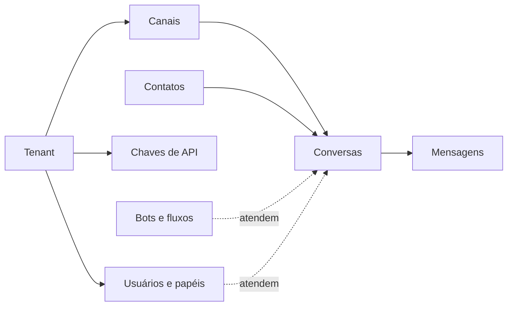
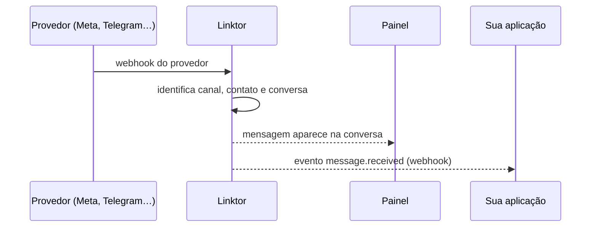

# Conceitos

O Linktor tem poucas peças. Entendê-las uma vez serve para o painel, para a API e para todos os canais.

## As peças

| Conceito | O que é |
|---|---|
| **Tenant** | A sua organização dentro do Linktor. Tudo — canais, contatos, conversas, usuários, chaves — pertence a um tenant, e um tenant nunca enxerga dados de outro. |
| **Canal** | Uma conexão com um meio de comunicação: um número de WhatsApp, um bot do Telegram, uma caixa de e-mail, um widget no site. Tem um **tipo** (`whatsapp_official`, `telegram`, `email`…), uma configuração e credenciais cifradas. |
| **Contato** | A pessoa do outro lado. Um contato pode ter várias **identidades** — o telefone no WhatsApp, o usuário no Telegram, o e-mail — e o Linktor as reúne na mesma ficha. |
| **Conversa** | O fio de mensagens entre um contato e a sua empresa em um canal. Tem status, responsável e histórico. |
| **Mensagem** | Um item da conversa: texto, imagem, áudio, vídeo, documento, localização, contato, template, mensagem interativa, figurinha, enquete, reação. |
| **Usuário** | Alguém da sua equipe com acesso ao painel. O que cada um pode fazer é definido pelo **papel**. |
| **Chave de API** | A credencial de um sistema (não de uma pessoa). Pertence a um tenant e carrega **scopes** que limitam o que ela pode fazer. |
| **Evento** | O aviso que o Linktor envia à sua aplicação quando algo acontece — mensagem recebida, entregue, lida, conversa atribuída. Chega por **webhook** ou por WebSocket. |
| **Bot** | Um atendente automático: um modelo de linguagem com instruções, base de conhecimento e regras de quando passar para um humano. |
| **Fluxo** | Um roteiro visual de atendimento, montado com nós e gatilhos. |

## O caminho de uma mensagem

**Entrada** — o cliente escreve:

1. O provedor chama o **webhook de entrada** do canal no Linktor.
2. O Linktor valida a chamada, encontra (ou cria) o contato e a conversa, e grava a mensagem.
3. A mensagem aparece no painel em tempo real e, se você configurou, a sua aplicação recebe o evento
   `message.received`.

**Saída** — a sua empresa responde:

1. Um atendente escreve no painel, um bot responde, ou a sua aplicação chama a API.
2. O Linktor **enfileira** a mensagem e responde na hora. A fila cuida de novas tentativas se o
   provedor falhar.
3. O adaptador do canal entrega ao provedor. A cada mudança, o status da mensagem avança e a sua
   aplicação é avisada: `message.sent`, `message.delivered`, `message.read` ou `message.failed`.

:::note Enfileirada não é entregue
A API responde assim que a mensagem entra na fila. O resultado real da entrega chega depois, pelos
eventos de status. Ver [Enviar mensagens](../api/enviar-mensagens.md) e
[Receber eventos](../api/receber-eventos.md).
:::

## Estados

| O quê | Estados |
|---|---|
| Conexão do canal | `disconnected` → `connecting` → `connected`, ou `error` |
| Conversa | `open` (aberta), `pending` (pendente), `resolved` (resolvida), `closed` (fechada) |
| Mensagem | `pending` → `sent` → `delivered` → `read`, ou `failed` |

Além do estado de conexão, um canal pode estar **habilitado** ou **desabilitado**: desabilitar pausa o
canal sem perder a configuração.

## Dois webhooks, dois sentidos

A palavra "webhook" aparece em dois lugares, com sentidos opostos:

| | Quem chama | Quem recebe | Onde configurar |
|---|---|---|---|
| **Webhook de entrada** | O provedor (Meta, Telegram, Twilio…) | O Linktor | No console do provedor, com a URL que o Linktor mostra para o canal |
| **Webhook de saída** | O Linktor | A sua aplicação | No Linktor, na configuração do canal |

As páginas de [Canais](../canais/visao-geral.md) tratam do primeiro;
[Receber eventos](../api/receber-eventos.md) trata do segundo.

## Quem faz o quê

| Papel | Em geral |
|---|---|
| `owner` / `admin` | Administra o tenant: canais, usuários, papéis, chaves de API, configurações. |
| `supervisor` | Acompanha a operação e a equipe. |
| `agent` | Atende conversas. |

Os papéis de sistema podem ser complementados por papéis personalizados. Detalhes em
[Usuários e papéis](../painel/usuarios-e-papeis.md).

## Próximo passo

- Usar o painel: [Primeiros passos](../guias/primeiros-passos.md).
- Integrar um sistema: [API → Visão geral](../api/visao-geral.md).
- Termos em ordem alfabética: [Glossário](glossario.md).
