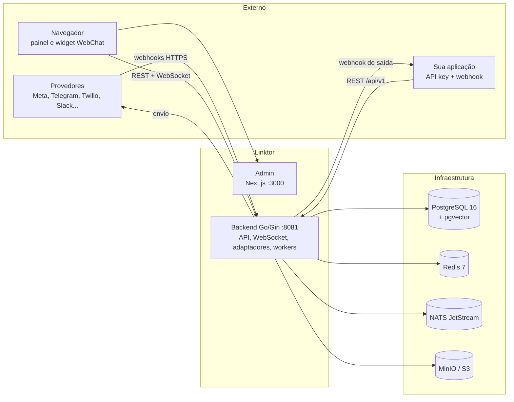
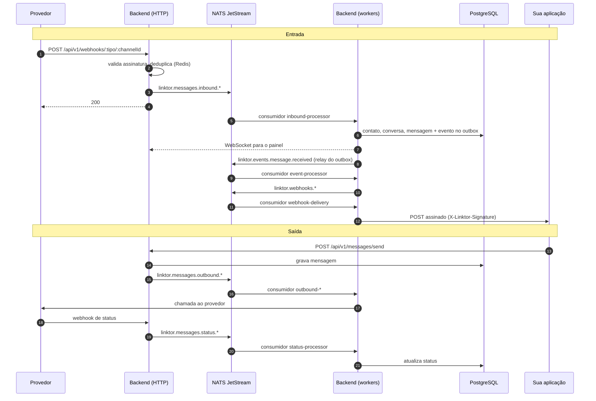

# Arquitetura

O Linktor é **um único processo Go** (API HTTP, WebSocket, adaptadores de canal e workers de fila no
mesmo binário) apoiado em quatro serviços de infraestrutura: PostgreSQL, Redis, NATS JetStream e um
armazenamento de objetos compatível com S3. O painel é uma aplicação Next.js separada, que só fala
com a API.

Esta página explica as peças e o caminho de uma mensagem. Para subir o sistema, vá para
[Instalação](./instalacao.md); para a lista de variáveis, [Configuração](./configuracao.md).

## Componentes

| Componente | Imagem / origem | Para que serve | O que acontece se cair |
|---|---|---|---|
| **Backend** | `Dockerfile` na raiz (`cmd/server`) | API REST em `/api/v1`, WebSocket do painel (`/api/v1/ws`) e do WebChat (`/ws/:channelId`), recebimento de webhooks, workers de envio, arquivos do widget em `/widget` | Tudo para. |
| **Admin** | `web/admin/Dockerfile` (Next.js) | Painel de atendimento e administração | A API continua recebendo e enviando; só a tela some. |
| **PostgreSQL** | `pgvector/pgvector:pg16` | Fonte da verdade: tenants, usuários, canais, contatos, conversas, mensagens, base de conhecimento (embeddings via `pgvector`), logs de canal | O backend não sobe (encerra na conexão ou na migration). |
| **Redis** | `redis:7.4-alpine` | Rate limit HTTP, deduplicação de webhooks recebidos, lista de revogação de mídia | O backend sobe com aviso no log; rate limit, deduplicação e revogação ficam **desligados**. |
| **NATS JetStream** | `nats:2.10-alpine` (`-js`) | Fila durável entre o recebimento do webhook e o processamento, e entre o pedido de envio e a entrega | O backend sobe com aviso (`messaging features disabled`); nenhuma mensagem entra ou sai, e `/ready` responde `503`. |
| **MinIO / S3** | `minio/minio` | Mídia recebida dos canais e anexos do WebChat | Sem armazenamento configurado, a mídia mantém a URL do provedor (que costuma exigir autenticação e expirar). |

O backend também grava em dois diretórios locais, que precisam de volume persistente:

| Caminho no container | Conteúdo |
|---|---|
| `/app/storages` | Sessões do WhatsApp não-oficial (um arquivo `whatsapp_<id do canal>.db` por canal). Sem este volume, todo redeploy exige parear de novo. |
| `/app/uploads` | Imagens geradas pelo VRE (`VRE_UPLOAD_DIR`) e, se você usar o armazenamento em disco em vez de MinIO, a mídia (`MEDIA_UPLOAD_DIR`). |

### Adaptadores de canal

Cada canal é um pacote em `internal/adapters/<canal>`. Há dois tipos:

- **Sem estado** (WhatsApp oficial, Telegram, SMS, Facebook, Instagram, RCS, e-mail, Teams, Slack,
  Mattermost, Direto): o envio é uma chamada HTTP feita com as credenciais do canal, lidas do banco a
  cada envio (com cache por canal).
- **Com estado** (WhatsApp não-oficial, WebChat, Linktor Bridge): mantêm uma conexão viva dentro do
  processo — a sessão `whatsmeow`, o WebSocket do visitante ou o WebSocket do aparelho.

Consequência prática: o backend **não é pensado para rodar em várias réplicas**. As sessões do
WhatsApp não-oficial, o hub do WebChat e o hub de agentes vivem na memória de um processo, e os
polls de e-mail (IMAP) e os listeners do Mattermost são iniciados por processo. Escale
verticalmente.

### Servidor MCP

O servidor MCP (`mcp/linktor-mcp-server`) é um processo Node separado, executado na máquina do
assistente de IA por transporte `stdio`. Ele não faz parte do deploy do servidor: é um cliente da API
REST, configurado com `LINKTOR_API_URL` e `LINKTOR_API_KEY`. Veja [MCP](../mcp/visao-geral.md).

## Caminho de uma mensagem

Recebimento e envio são desacoplados por filas. O webhook do provedor recebe `200` assim que a
mensagem é publicada no NATS; o processamento (gravar no banco, notificar o painel, disparar bot e
webhook de saída) acontece depois, com nova tentativa em caso de falha.

### Streams

Os streams são criados (ou atualizados) pelo backend na inicialização; não há passo manual no NATS.
Todos usam armazenamento em arquivo e o número de réplicas de `nats.stream_replicas` (padrão `1`).

| Stream | Subjects | Retenção | Idade máxima | Conteúdo |
|---|---|---|---|---|
| `LINKTOR_MESSAGES` | `linktor.messages.inbound.>`, `linktor.messages.outbound.>`, `linktor.messages.status.>` | fila de trabalho | 7 dias (limite de 500 MB, 4 MB por mensagem) | Mensagens recebidas, pedidos de envio e atualizações de status. O último segmento do subject é o tipo do canal. |
| `LINKTOR_EVENTS` | `linktor.events.>` | por interesse | 1 dia | Eventos internos (`message.received`, `message.sent`, `conversation.created`...). |
| `LINKTOR_WEBHOOKS` | `linktor.webhooks.>` | fila de trabalho | 3 dias | Entregas pendentes do webhook de saída; o último segmento é o id do tenant. |
| `LINKTOR_AI` | `linktor.bot.>` | fila de trabalho | 1 dia | Análise e resposta de bots. |
| `LINKTOR_DLQ` | `linktor.dlq.>` | por limites | 14 dias | Mensagens que esgotaram as tentativas, um subject por consumidor (`linktor.dlq.<consumidor>`). |

`LINKTOR_MESSAGES` e `LINKTOR_AI` descartam publicações repetidas com o mesmo id em uma janela de 5
minutos (deduplicação nativa do JetStream).

### Consumidores, retry e DLQ

| Consumidor | Stream | Tentativas | Prazo de ack |
|---|---|---|---|
| `inbound-processor` | `LINKTOR_MESSAGES` | 5 | 30 s |
| `outbound-<tipo do canal>` | `LINKTOR_MESSAGES` | 5 | 60 s |
| `status-processor` | `LINKTOR_MESSAGES` | 3 | 10 s |
| `event-processor` | `LINKTOR_EVENTS` | 3 | 10 s |
| `webhook-delivery` | `LINKTOR_WEBHOOKS` | 10 | 30 s |
| `ai-analyzer` | `LINKTOR_AI` | 3 | 30 s |
| `ai-responder` | `LINKTOR_AI` | 3 | 60 s |
| `ai-escalation` | `LINKTOR_AI` | 5 | 30 s |
| `dlq-observer` | `LINKTOR_DLQ` | 5 | 30 s |

A regra é a mesma para todos:

1. O handler retorna erro → a mensagem é devolvida à fila e reentregue depois de **5 segundos**.
2. Na última tentativa permitida, em vez de reentregar, a mensagem é copiada para
   `linktor.dlq.<consumidor>` e confirmada na fila de origem. Se a própria publicação na DLQ falhar,
   ela volta à fila com espera de 30 segundos — não se perde.
3. O `dlq-observer` registra cada mensagem morta no log do backend. As mensagens ficam 14 dias no
   stream `LINKTOR_DLQ` para inspeção; **não há reprocessamento automático**.

Nem todo erro gera nova tentativa. Na entrada, duplicata, validação, acesso negado e "não
encontrado" são confirmados e descartados (com registro em **Observabilidade → Logs**), porque
repetir não muda o resultado. Na saída, falha permanente do provedor (credencial inválida, número
inexistente) marca a mensagem como falha sem repetir; só falha transitória volta para a fila.

O worker de saída limita o envio a 80 mensagens por segundo por canal.

### Outbox

O evento `message.received` é gravado na tabela `outbox_events` na mesma transação que a mensagem.
Um relay publica os pendentes no NATS a cada 2 segundos, com a chave de idempotência do evento. Isso
garante que uma mensagem gravada sempre gera o evento, mesmo que o NATS esteja fora no instante da
gravação.

## Multi-tenancy

Uma instalação atende vários **tenants** (empresas) no mesmo banco. Toda tabela de negócio tem a
coluna `tenant_id`, e o isolamento é feito na aplicação:

- O tenant vem **sempre** da credencial: do JWT do usuário ou da chave de API. Nenhuma rota aceita
  `tenant_id` no corpo ou na URL.
- Nos webhooks de provedores, o tenant é resolvido a partir do canal (`:channelId` na URL).
- Os subjects de webhook de saída e de bots carregam o id do tenant (`linktor.webhooks.<tenant>`),
  mas os consumidores são compartilhados: não há fila dedicada por tenant.

Não há separação por schema ou por banco. Para isolar clientes fisicamente, suba instalações
separadas.

:::note Como um tenant é criado
A API não tem rota de cadastro de tenant. O único caminho no código é o seed de inicialização, que
cria um tenant e dois usuários quando a tabela `users` está vazia. Veja
[Instalação](./instalacao.md) e [Produção](./producao.md).
:::

## Onde ficam os segredos

| Segredo | Onde fica | Proteção |
|---|---|---|
| Credenciais de canal (tokens da Meta, senha SMTP, `bot_token`...) | Tabela `channels`, colunas `credentials` (inteira) e `config` (só as chaves sensíveis) | AES-256-GCM, valor gravado como `enc:v1:<base64>`. A chave é derivada de `crypto.encryption_key` (`LINKTOR_CRYPTO_ENCRYPTION_KEY`). |
| Senhas de usuário | Tabela `users` | Hash bcrypt. |
| Chaves de API (`lk_...`) | Tabela `api_keys` | Hash bcrypt; a chave em claro só aparece na criação. |
| Segredo do JWT | `jwt.secret` (`LINKTOR_JWT_SECRET`) | Só em variável de ambiente ou `config.yaml`. |
| Segredo das URLs de mídia | `MEDIA_SIGNING_SECRET` | Só em variável de ambiente. |
| Sessões do WhatsApp não-oficial | Arquivos em `/app/storages` | **Sem cifragem** — proteja o volume e os backups. |

Perder `LINKTOR_CRYPTO_ENCRYPTION_KEY` significa perder todas as credenciais de canal: o banco
restaurado não é legível com outra chave. Guarde-a junto com os backups, em local separado. A troca
de chave está em [Backup e atualização](./backup-e-atualizacao.md); o modelo de segurança completo,
em [Segurança](./seguranca.md).
